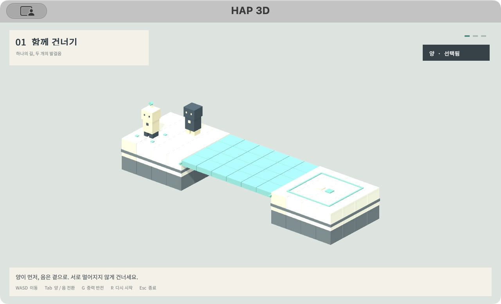
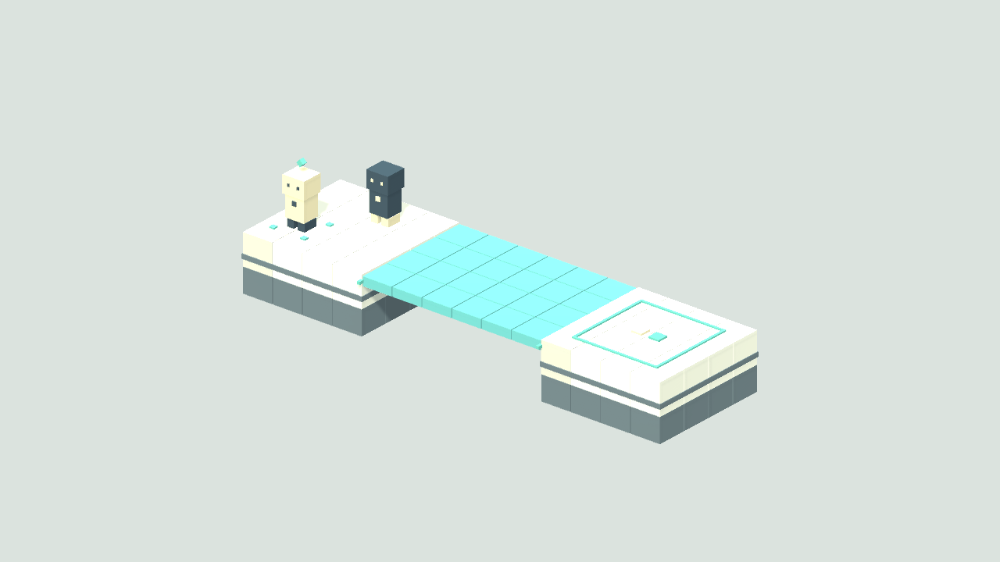
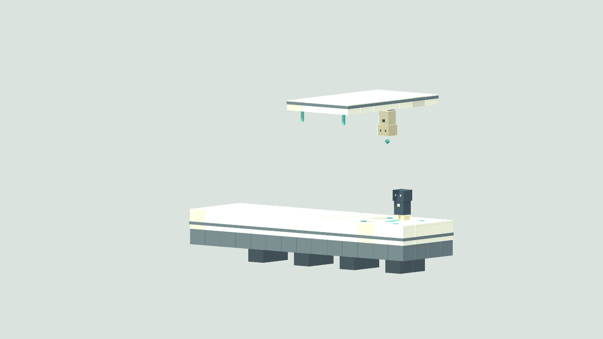
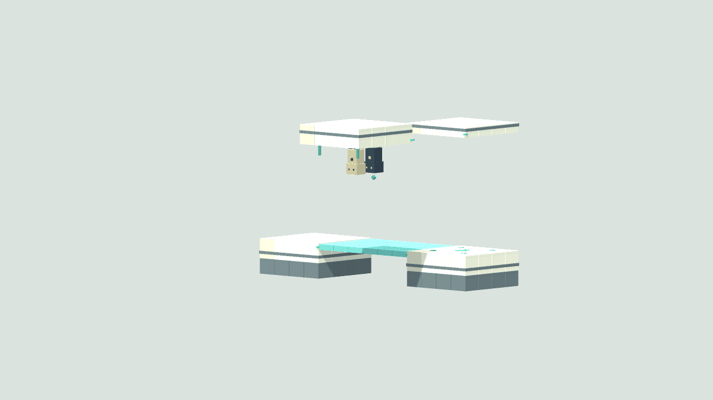
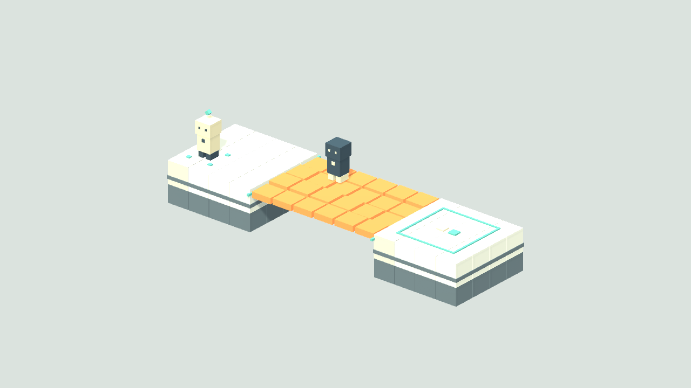

# HAP 3D

HAP 3D는 세 개의 빛블록 퍼즐을 완성한 PC 게임 개발 프리뷰다. 양과 음을 한 명이 번갈아 조작하며 바닥과 천장을 오가고, 두 캐릭터를 공동 목표에 도착시킨다.

**v0.1.0 프리릴리스 다운로드:** [macOS Universal](https://github.com/ApexLegendIsFun/HAP3D/releases/download/v0.1.0/HAP3D-v0.1.0-Mac.zip) · [Windows 64비트](https://github.com/ApexLegendIsFun/HAP3D/releases/download/v0.1.0/HAP3D-v0.1.0-Windows.zip) · [릴리스 정보와 체크섬](https://github.com/ApexLegendIsFun/HAP3D/releases/tag/v0.1.0)



## 세 퍼즐

- **함께 건너기:** 빛길을 함께 건너 바닥의 공동 목표에 도착한다.
- **다른 바닥:** 영구 발판에서 중력을 반전해 천장으로 올라간 뒤 옆길로 이동한다.
- **뒤집혀도 함께:** 아래 빛다리에서 안전 발판으로 이동하고, 중력을 반전해 천장 빛다리를 건넌 뒤 공동 목표에 도착한다.

빛블록은 양 단독이면 길을 유지하고, 음 단독 접근이면 붕괴하며, 양과 음이 함께 있으면 안정된 길이 된다.

화면은 작은 복셀 블록섬, 흑백 캐릭터, 청록 빛길, 고정 사선 직교 시점으로 구성한다. 모바일 게임은 비주얼 참고 자료이며 현재 대상 플랫폼은 아니다. 행성 표면과 내부 공간은 후속 확장 후보이다.

## 조작

시작 화면에서 **Enter**를 누른다. 단계 완료 뒤 **Enter**로 다음 단계로 가거나 다시 플레이한다.

- **WASD:** 선택 캐릭터 이동
- **Tab:** 양/음 캐릭터 전환
- **G:** 접지 중 선택 캐릭터의 중력 반전
- **R:** 현재 플레이 재시작
- **Esc:** 게임 종료

PC 1인 플레이와 WASD/Tab 전환 조작은 승인된 범위다. 점프와 공중 이동은 없다. G의 개별 접지 반전 방식은 실험 구현이다.

## 검증과 빌드 현황

Unity 컴파일과 그래픽을 포함한 13단계 검증이 종료 코드 0으로 통과했다. 로그: `/tmp/hap3d-voxel-validation-release.log` (`HAP3D_VALIDATION_OK`). 세 구간의 작성된 시작 위치에서 **검증용 이동 입력**으로 실제 이동·캐릭터 전환·중력 반전·완료까지 확인했다. 자동 검증은 이동 경로를 순간 배치하지 않으며, 실제 키보드 입력 검증과는 구분한다. 경고 중 합류하면 붕괴가 취소되고 안정화되는 동작, 붕괴 유지와 복구, 한 캐릭터만 목표에 도착했을 때 미완료, 위·아래 층의 독립 판정도 확인했다. 시작 화면의 본문과 렌더 자세, 단계 전환 후 오브젝트 정리, 현재 단계에서 R 재시작도 확인했다.

macOS Universal(Apple Silicon/Intel) 빌드가 성공했고 실행도 확인했다. 로그: `/tmp/hap3d-voxel-build-mac-release.log`. macOS에서 Enter 시작, D 약 700ms 이동, Tab 전환, G 반전, R 재시작, Esc 종료를 직접 확인했다. Player.log에 게임 예외는 없었다.

Windows 64비트 빌드는 성공했다. 로그: `/tmp/hap3d-voxel-build-windows-release.log`. Windows PC에서 실행하는 검증은 아직 하지 않았다. 처음 하는 사람 대상 플레이 테스트도 아직 하지 않았으며, 3~5분 목표 분량은 확인 전이다.

소스 커밋 `4f56a3b`를 원격 `main`에 push했다. [공개 GitHub 저장소](https://github.com/ApexLegendIsFun/HAP3D)에 프리릴리스 [v0.1.0](https://github.com/ApexLegendIsFun/HAP3D/releases/tag/v0.1.0)을 공개했다. macOS ZIP은 44,430,878바이트(SHA-256 `582e9bb2d918a43288425605ad97c14d835b1ad94d53f532b6a26ca66bbd59f6`), Windows ZIP은 36,017,544바이트(SHA-256 `f4aa3c36e7facdc885be79793ae652710c97c777bd8cc5b970ffba08ecadab10`)이며 원격 업로드 후 로컬 파일과 digest 일치를 확인했다. 체크섬 파일도 릴리스에 포함된다.

학교 제출 안내의 [Git Repository 항목](https://app.notion.com/p/3e4caf5650aa80309c09fd9cf7c1705a)에 저장소 링크를 입력했고, 페이지를 다시 불러와 반영된 링크를 확인했다. Windows 실행 확인과 초행자 플레이 테스트는 아직 남아 있다.

## 스크린샷









## Unity에서 열고 실행하기

Unity **6000.3.19f1**로 프로젝트를 연다. Unity Hub에서 이 폴더를 추가한 뒤 `HAP3D > Open Prototype`을 선택하고 Play를 누른다. 학교 지정 Unity 버전은 확인되지 않았다.

## 검증·빌드 명령

Unity 실행파일과 프로젝트 경로를 환경에 맞게 지정한 뒤 필요한 명령을 실행한다. 검증 명령은 자체 종료하므로 `-quit`을 붙이지 않는다.

```sh
HAP3D_UNITY="/Applications/Unity/Hub/Editor/6000.3.19f1/Unity.app/Contents/MacOS/Unity"
HAP3D_PROJECT="/Users/leeseondong/HAP3D"

"$HAP3D_UNITY" -batchmode -quit -projectPath "$HAP3D_PROJECT" -executeMethod HAP3D.Editor.ProjectSetup.CreateSetupScene -logFile /tmp/hap3d-setup.log
"$HAP3D_UNITY" -batchmode -projectPath "$HAP3D_PROJECT" -executeMethod HAP3D.Editor.PrototypeValidation.Run -logFile /tmp/hap3d-validation.log
"$HAP3D_UNITY" -batchmode -nographics -quit -projectPath "$HAP3D_PROJECT" -executeMethod HAP3D.Editor.ProjectSetup.BuildMacSetup -logFile /tmp/hap3d-build-mac.log
"$HAP3D_UNITY" -batchmode -nographics -quit -projectPath "$HAP3D_PROJECT" -executeMethod HAP3D.Editor.ProjectSetup.BuildWindowsSetup -logFile /tmp/hap3d-build-windows.log
```

Unity 메뉴는 `HAP3D > Open Prototype`, `HAP3D > Validate Prototype`, `HAP3D > Build Mac Prototype`, `HAP3D > Build Windows 64-bit Prototype`이다. 빌드 폴더는 `Builds/MacPrototype/`와 `Builds/WindowsPrototype/`이다. 실행 파일과 함께 폴더 전체, `README.txt`, `THIRD_PARTY_NOTICES.txt`를 전달한다.

## 글꼴 라이선스

프로젝트는 Noto Sans KR 정적 Regular(weight 400) 글꼴을 사용한다. 원본 변수 글꼴의 기본 weight 100 대신 실행 시 400 굵기를 고정했다. 라이선스는 SIL Open Font License 1.1이며 [`Assets/HAP3D/Fonts/OFL-NotoSansKR.txt`](Assets/HAP3D/Fonts/OFL-NotoSansKR.txt)에 보관한다. 출처: [Google Fonts — Noto Sans KR](https://github.com/google/fonts/tree/main/ofl/notosanskr). 배포 빌드에는 `THIRD_PARTY_NOTICES.txt`를 포함한다.

## 기존 개발·제출 기록

다음은 **2026년 10월 2일 초기 단일 구간 프로토타입과 기획서 v0.4 이력**이다. 현재 세 퍼즐의 검증·빌드 결과와 구분한다.

- 초기 프로토타입의 8개 물리 검증 항목과 통합 이동 경로 통과 기록이 있다.
- macOS Universal 초기 프로토타입 실행과 Tab/R/Esc 조작 확인 기록이 있다. 실행 앱과 한국어 `README.txt`를 포함해 폴더 ZIP으로 묶었다.
- 학교 제출 기획서 PDF는 v0.4다. 2026년 10월 2일 15:40(KST)에 v0.3을 올리고 16:05(KST)에 같은 Drive 파일을 v0.4로 교체했다. 여섯 쪽을 다시 확인하고 Drive 재다운로드 파일의 SHA-256 일치를 기록했다.
- 대시보드 이선동 39행에 장르와 v0.4 PDF 링크를 등록하고 확인했다. 현재 Notion Git Repository 등록 및 GitHub Release와는 별도 기록이다.

[학교 제출 기획서 PDF v0.4](https://drive.google.com/file/d/1sHmk9p7y0N3biVttB8yMGy-Z35lnrqFJ/view)는 제출 보관본이다. [기획 원문 v0.5](Docs/이선동_HAP3D_기획서_원문.txt)는 2026년 10월 13일자 최신 문서다. 개발 이력 전체는 [작업목록](Docs/작업목록.txt)에 보존한다.

## 학교 일정과 안내

프로젝트 일정은 2026년 9월 30일~11월 16일이다. 학교 안내상 기획서 PDF는 10월 5일 18시, 피드백·컨펌은 10월 6일까지, 1차 빌드는 10월 23일 23:59, 2차 빌드는 11월 6일 23:59, 최종 빌드·시연 영상은 11월 16일 12시다. 별도 안내의 11월 13일 일정과 차이가 있어 멘토 확인이 필요하다.

- [학교 2차 프로젝트 안내](https://app.notion.com/p/2-bf1caf5650aa820aa2df81b6242cb356)
- [학교 제출 및 Git Repository 등록 안내](https://app.notion.com/p/3e4caf5650aa80309c09fd9cf7c1705a)
- [기획서 대시보드 — 이선동 39행](https://docs.google.com/spreadsheets/d/1P_7ibbiIDOKYZa3Jf7oi57FDPmPXyOCvfecwVNF-zZs/edit?gid=0&range=A39:L39)

## 참고 문서

- [기획 원문 v0.5](Docs/이선동_HAP3D_기획서_원문.txt)
- [작업목록](Docs/작업목록.txt)
- [빌드 README 양식](Docs/README_빌드양식.txt)
